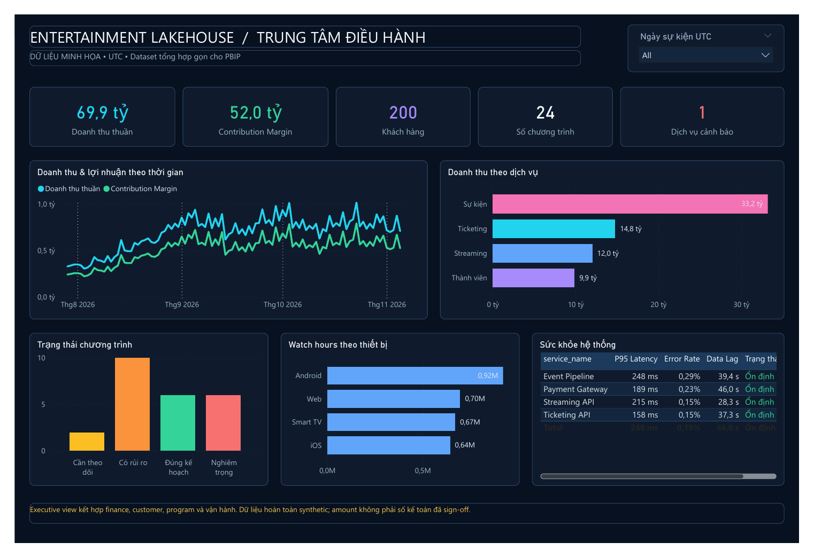
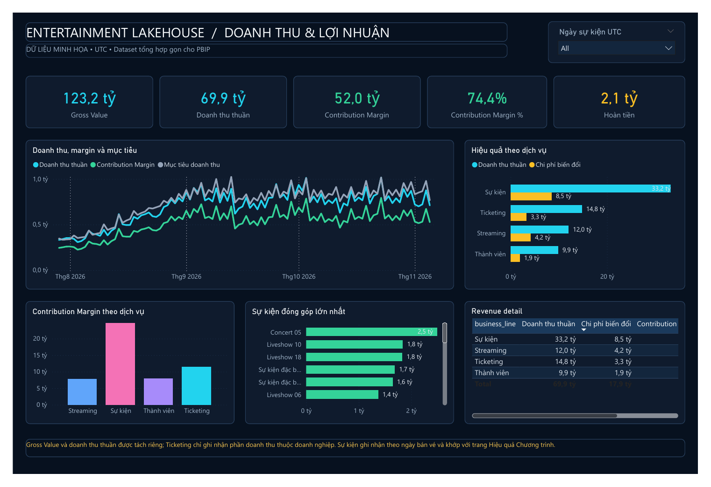
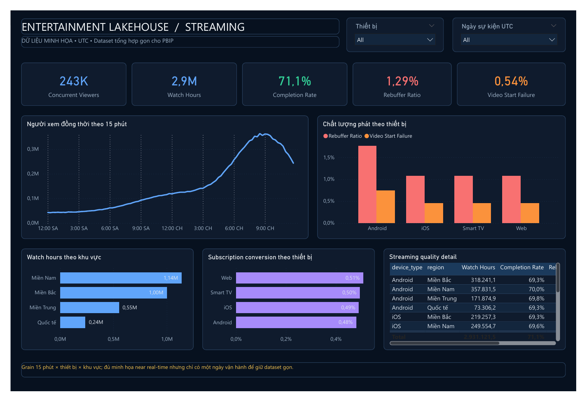
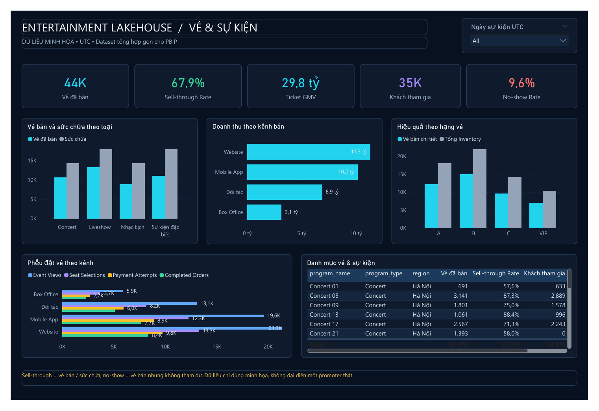
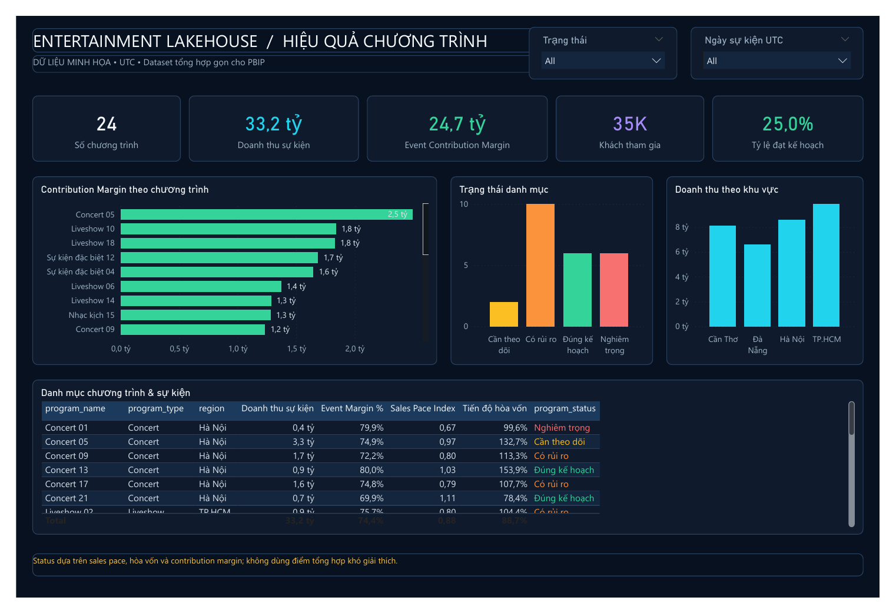
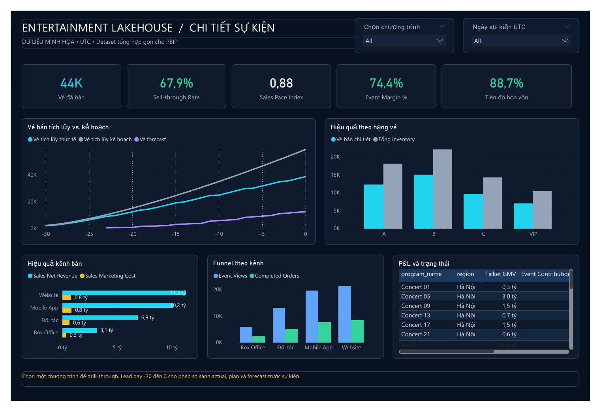
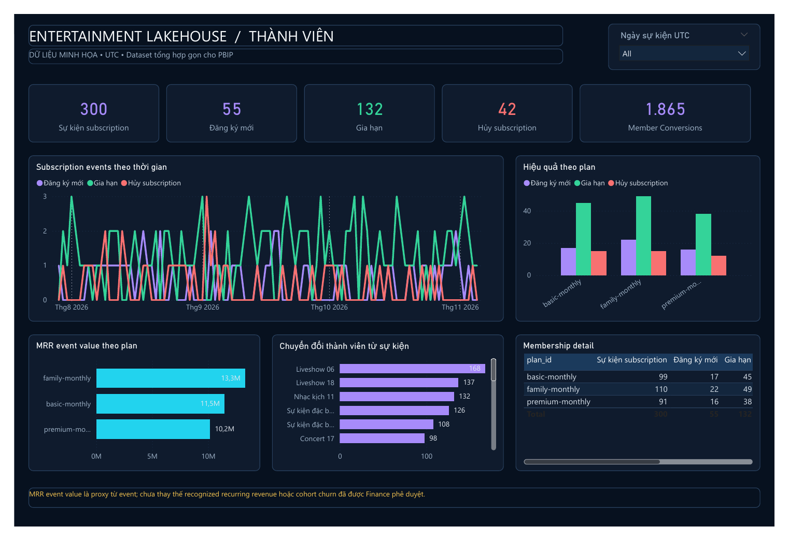
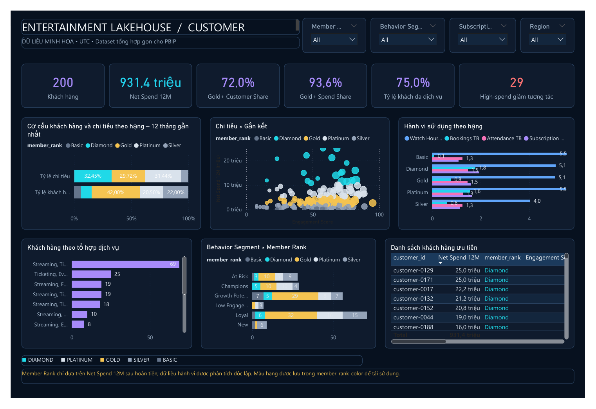
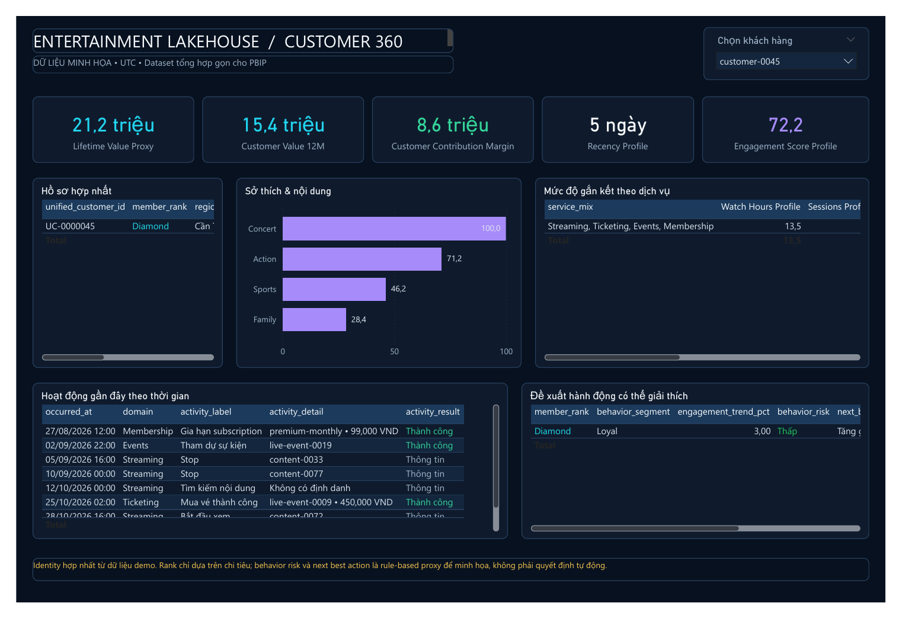
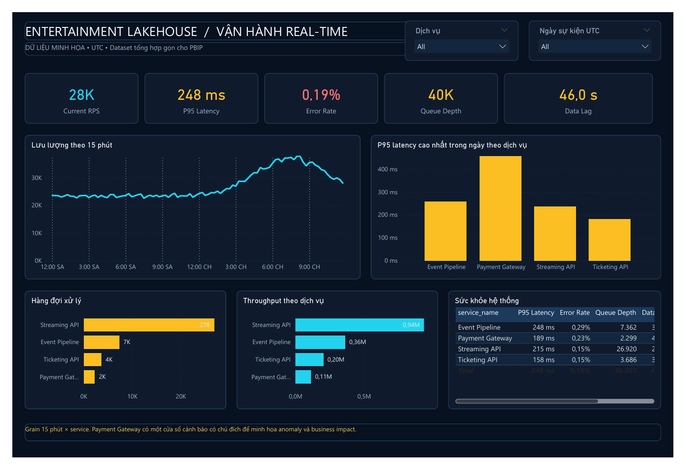

# Entertainment Real-Time Lakehouse

[Tiếng Việt](#tiếng-việt) · [English](#english)

## Tiếng Việt

Dự án mô phỏng nền tảng dữ liệu gần real-time cho doanh nghiệp giải trí, bao phủ streaming, bán vé, sự kiện và membership. Sự kiện được đưa qua Kafka, kiểm tra schema, xử lý retry/DLQ/deduplication, lưu theo kiến trúc lakehouse Bronze - Silver - Gold trên Apache Iceberg, truy vấn bằng Trino và trình bày trên Power BI.



### Dashboard Power BI 10 trang

Dashboard gồm 10 góc nhìn từ điều hành, tài chính, streaming, vé và sự kiện đến Customer 360 và vận hành real-time. Có thể xem nhanh toàn bộ bản xuất tại [EntertainmentAnalytics.pdf](dashboard/EntertainmentAnalytics.pdf) hoặc mở project [EntertainmentAnalytics.pbip](dashboard/EntertainmentAnalytics.pbip) bằng Power BI Desktop.

| 1. Trung tâm điều hành | 2. Doanh thu & Lợi nhuận |
|---|---|
|  |  |
| 3. Streaming | 4. Vé & Sự kiện |
|  |  |
| 5. Hiệu quả Chương trình | 6. Chi tiết Sự kiện |
|  |  |
| 7. Thành viên | 8. Customer Portfolio & Spend Ranking |
|  |  |
| 9. Customer 360 Profile | 10. Vận hành Real-time |
|  |  |

### Kiến trúc

```text
Streaming / Booking / Attendance / Subscription events
                         |
                         v
                  Apache Kafka (4 topic + DLQ)
                         |
          schema validation - retry - DLQ - dedupe
                         |
                         v
        RustFS (S3) + Apache Iceberg: Bronze -> Silver -> Gold
                         |
                       Trino
                         |
                 Power BI (PBIP, 10 trang)
```

### Bắt đầu nhanh trên Windows

Clone hoặc tải toàn bộ repository, sau đó chạy file phù hợp tại thư mục gốc. Không cần cài Python.

| File chạy | Chức năng | Yêu cầu | Thời gian dự kiến |
|---|---|---|---|
| `1_Open_Dashboard.bat` | Cập nhật đường dẫn dữ liệu mẫu và mở dashboard | [Power BI Desktop](https://apps.microsoft.com/detail/9ntxr16hnw1t) | Khoảng 1 phút |
| `2_Run_Pipeline_Demo.bat` | Chạy Kafka -> Iceberg -> Trino -> CSV Power BI và in kết quả nghiệm thu | [Docker Desktop](https://www.docker.com/products/docker-desktop/), khoảng 8 GB RAM trống | 5-10 phút lần đầu |
| `3_Run_Tests.bat` | Chạy toàn bộ automated tests trong container Python 3.12 | Docker Desktop | Khoảng 2 phút |
| `4_Stop_Pipeline.bat` | Tắt stack và xóa dữ liệu demo trong Docker | Docker Desktop | Dưới 1 phút |

Các script dùng Docker Compose project riêng `rtdp-demo`, không ảnh hưởng các container khác trên máy.

### Kết quả đã nghiệm thu

- 40/40 sự kiện được publish và xử lý; consumer lag bằng 0; không có `event_id` trùng.
- P95 event-to-Silver có thể truy vấn là 9,3 giây, thấp hơn SLA 60 giây.
- Gold reconciliation khớp Silver theo từng domain.
- Replay và restart consumer không làm mất hoặc nhân đôi dữ liệu.
- 42/42 automated tests pass.
- Power BI gồm 16 bảng, 127 DAX measures, 12 relationships, 10 trang và 149 visuals.

Xem [báo cáo nghiệm thu](back/docs/final-acceptance-report-2026-11-06.md) và bằng chứng trong `back/artifacts/acceptance/`.

### Cấu trúc repository

```text
.
├── dashboard/                 # PBIP, semantic model, PDF và ảnh dashboard
├── back/                      # Backend, data contracts, SQL, IaC, tests và tài liệu kỹ thuật
├── 1_Open_Dashboard.bat       # Mở Power BI với dữ liệu mẫu
├── 2_Run_Pipeline_Demo.bat    # Chạy pipeline end-to-end
├── 3_Run_Tests.bat            # Chạy automated tests
├── 4_Stop_Pipeline.bat        # Dừng và dọn stack demo
└── README.md
```

Tài liệu chi tiết:

- [Kịch bản demo 10 phút](back/DEMO_GUIDE.md)
- [Tài liệu kỹ thuật đầy đủ](back/TECHNICAL_README.md)
- [Kiến trúc và data flow](back/docs/architecture.md)
- [Định nghĩa metric Gold](back/docs/gold-metric-definitions.md)
- [Runbook triển khai OCI](back/docs/phase-6a-oci-deployment.md)

### Công nghệ

Apache Kafka 4.1 · Python 3.12 · JSON Schema · Apache Iceberg · RustFS · Trino · SQL · Power BI PBIP/TMDL/DAX · Docker Compose · Terraform (OCI) · pytest

### Phạm vi và lưu ý

- Toàn bộ dữ liệu là dữ liệu tổng hợp, không chứa thông tin cá nhân thật.
- Metric có hậu tố `_proxy` phục vụ phân tích, không phải số liệu kế toán đã xác nhận.
- Stack local là PoC single-node, không đại diện cho production có HA/DR.
- Dashboard dùng Import từ CSV; Power BI refresh vẫn là bước thủ công.
- Terraform OCI đã được kiểm tra cấu trúc nhưng chưa triển khai lên tenancy thật.

---

## English

This project demonstrates a near-real-time data platform for an entertainment business across streaming, ticketing, live events, and membership. Events flow through Kafka for schema validation, retry/DLQ handling, and deduplication; land in Bronze, Silver, and Gold Apache Iceberg layers; are queried with Trino; and are presented in a 10-page Power BI dashboard.

### Dashboard

The complete dashboard gallery is shown in the [Vietnamese section](#dashboard-power-bi-10-trang). You can also view the exported [PDF](dashboard/EntertainmentAnalytics.pdf) or open the [PBIP project](dashboard/EntertainmentAnalytics.pbip) in Power BI Desktop.

### Architecture

```text
Business events -> Kafka + DLQ -> validation/deduplication
                -> Iceberg Bronze/Silver/Gold on RustFS
                -> Trino -> Power BI
```

### Quick start on Windows

Clone or download the full repository, then run one of the root-level launchers. Python is not required locally.

| Launcher | Purpose | Requirement |
|---|---|---|
| `1_Open_Dashboard.bat` | Point the model to the bundled sample data and open Power BI | Power BI Desktop |
| `2_Run_Pipeline_Demo.bat` | Run the end-to-end pipeline and print acceptance results | Docker Desktop and about 8 GB free RAM |
| `3_Run_Tests.bat` | Run the automated test suite in Python 3.12 Docker | Docker Desktop |
| `4_Stop_Pipeline.bat` | Stop the stack and remove demo Docker data | Docker Desktop |

The demo uses the isolated Docker Compose project name `rtdp-demo`.

### Verified results

- 40/40 events published and processed, zero consumer lag, and no duplicate `event_id` values.
- 9.3-second P95 event-to-queryable-Silver latency against a 60-second SLA.
- Gold-to-Silver reconciliation passed for every domain.
- Replay and consumer restart tests produced no loss or duplication.
- 42/42 automated tests passed.
- Power BI contains 16 tables, 127 DAX measures, 12 relationships, 10 pages, and 149 visuals.

See the [final acceptance report](back/docs/final-acceptance-report-2026-11-06.md), [technical documentation](back/TECHNICAL_README.md), and [architecture guide](back/docs/architecture.md).

### Scope notes

- All data is synthetic and contains no real personal information.
- Metrics ending in `_proxy` are analytical indicators, not finance-approved accounting figures.
- The local stack is a single-node proof of concept, not a production HA/DR design.
- Power BI uses CSV Import mode and requires a manual refresh.
- The OCI Terraform blueprint was structurally validated but has not been applied to a live tenancy.
