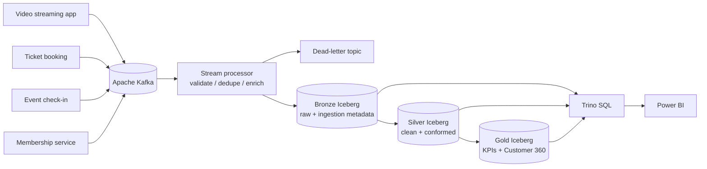

# Kiến trúc đề xuất

## 1. Kiến trúc logic

## 2. Data flow và trách nhiệm từng lớp

### Ingestion

- Producer tạo immutable event và dùng UTC ISO-8601 cho `occurred_at`.
- Topic được version hóa để schema breaking change không làm hỏng consumer cũ.
- Partition key ưu tiên giữ thứ tự theo entity: booking theo `booking_id`; customer activity/subscription theo `customer_id`.
- Kafka retention phục vụ buffer và replay; Kafka không thay vai trò long-term storage.

### Stream processing

Thành phần này sẽ được triển khai ở phase tiếp theo bằng Python consumer cho PoC; production có thể chuyển sang Flink/Kafka Streams khi throughput và stateful processing yêu cầu.

Trách nhiệm:

1. Validate JSON Schema và business rules.
2. Gắn `ingested_at`, source topic, partition, offset.
3. Dedupe theo `event_id` trong cửa sổ phù hợp.
4. Ghi lỗi có trace vào DLQ.
5. Micro-batch dữ liệu thành Parquet/Iceberg để tránh small-file problem.

### Lakehouse

| Layer | Mục đích | Quy tắc chính |
|---|---|---|
| Bronze | Audit/replay gần nguồn | Append-only, giữ payload và Kafka metadata |
| Silver | Dữ liệu sạch, conformed | Dedupe, chuẩn hóa type/timezone/status, xử lý late data |
| Gold | Phục vụ BI | Star schema/aggregate ổn định, business definitions rõ ràng |

Namespace khởi tạo: `iceberg.bronze`, `iceberg.silver`, `iceberg.gold`.

### Serving

- Trino là SQL access layer trên Iceberg.
- Dashboard cần latency thấp có thể dùng DirectQuery qua driver/gateway phù hợp.
- Báo cáo lịch sử có thể dùng Import + incremental refresh để giảm tải truy vấn.
- Chỉ expose bảng/view Gold cho người dùng BI thông thường.

## 3. Gold data products dự kiến

| Data product | Grain | KPI chính |
|---|---|---|
| `gold.content_engagement_hourly` | hour x content x device | active users, plays, completion rate, watch time |
| `gold.booking_funnel_daily` | day x event/content x channel | initiated, confirmed, cancelled, conversion, revenue |
| `gold.event_performance` | event | tickets sold, attendance, no-show rate, revenue |
| `gold.subscription_daily` | day x plan | active members, new, renewals, churn, MRR proxy |
| `gold.customer_360` | customer | last activity, favorite content, bookings, attendance, subscription status |
| `gold.customer_journey` | customer event | timeline, domain/action, content, booking, attendance, subscription context |

`MRR proxy` chỉ là số đo thiết kế ban đầu; không được xem là MRR kế toán trước khi business chốt recognition rules.

### Gold implementation (Phase 4)

Sáu data products trên đã được triển khai thành Iceberg tables trong `iceberg.gold`. Chúng được rebuild từ snapshot `iceberg.silver.events` bằng staging-and-swap; mỗi model refresh ghi một record vào `gold.refresh_audit`. SQL nguồn nằm trong `sql/gold/` và định nghĩa nghiệp vụ chi tiết nằm tại `docs/gold-metric-definitions.md`.

## 4. Ánh xạ local PoC sang Oracle/OCI

| Local PoC | Vai trò | Ứng viên production Oracle/OCI |
|---|---|---|
| Apache Kafka single broker | Event backbone | OCI Streaming with Apache Kafka |
| RustFS single node | S3-compatible object storage; thay MinIO CE đã EOL | OCI Object Storage |
| Python stream processor | Validate/dedupe/enrich | OCI Data Flow Spark Structured Streaming |
| Iceberg REST fixture | Metadata catalog cho lab | Iceberg tables/catalog trên OCI Object Storage theo cấu hình được Oracle hỗ trợ |
| Trino single coordinator | Federated SQL/query layer | Autonomous AI Lakehouse query trên Object Storage/Iceberg |
| Power BI CSV Import | Semantic/reporting | Power BI Oracle connector qua private network/gateway; Import incremental hoặc DirectQuery theo SLA |

Terraform foundation cho ánh xạ này nằm tại `infra/terraform/oci`. Đây vẫn là kiến trúc đích chưa được apply; version/shape/quota, IAM, networking, license và chi phí phải được xác nhận trong tenancy thật.

## 5. Reliability và observability cần bổ sung

- Consumer lag, records/sec, error rate và rebalance count.
- Event-time latency theo P50/P95/P99.
- DLQ volume theo source/schema error.
- Iceberg commit duration, file count/size và compaction backlog.
- Data quality: null key, duplicate event, invalid status, reconciliation amount/count.
- Alert và runbook cho Kafka unavailable, object store full, catalog unavailable và Trino query failure.

