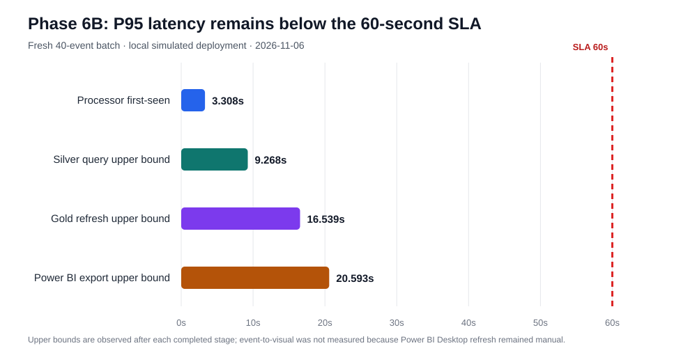

# Local PoC đáp ứng SLA mô phỏng; OCI được bàn giao dưới dạng deployment blueprint

## Executive Summary

- Project **sẵn sàng trong phạm vi bài test mô phỏng local**. Batch nghiệm thu mới gồm 40 events, chia đều 10 events cho mỗi domain; producer delivery 40/40, processor valid 40/40, không có invalid record hoặc duplicate trong batch.
- NFR-01 đạt trên batch nghiệm thu: P95 processing là **3.308 giây**, P95 event-to-Silver query upper bound **9.268 giây**, sau Gold refresh **16.539 giây**, và sau governed CSV export **20.593 giây**—đều dưới mục tiêu 60 giây.
- Gold tiếp tục reconcile tuyệt đối với Silver: 30/30 events cho từng domain, booking confirmed/refunded amounts khớp, và Customer 360 có 97/97 customer keys duy nhất.
- Oracle/OCI không được triển khai thật theo phạm vi đã chốt. Terraform là blueprint đã validate; event-to-visual live cũng chưa đo vì Power BI Desktop refresh vẫn thủ công. Hai giới hạn này không chặn bài nộp mô phỏng nhưng phải được giữ trong phần trình bày.



## 1. Phạm vi nghiệm thu

Nghiệm thu dùng local stack Kafka 4.1.0, RustFS, Iceberg REST fixture, Trino 484, Python producer/processor, Gold builder và PBIP source. OCI Terraform được kiểm tra như kiến trúc triển khai giả lập, không apply và không phát sinh tài nguyên cloud.

Batch kiểm tra cuối:

| Thuộc tính | Giá trị |
|---|---:|
| Run | `20261106T093545Z` |
| Correlation ID | `f7aa0c81-e462-4d42-b530-ee14698b191e` |
| Seed | `1793957745` |
| Events | 40 |
| Tốc độ phát | 10 events/giây |
| Phân bổ domain | 10 booking, 10 attendance, 10 subscription, 10 user activity |
| Processor micro-batches | 4 |
| Consumer group | `entertainment-phase6b-20261106T093545Z` |

Nguồn kiểm soát: [`acceptance-summary.json`](../artifacts/acceptance/20261106T093545Z/acceptance-summary.json).

## 2. Latency và NFR-01

`processing_latency` là `first_seen_at - occurred_at`. `query upper bound` lấy thời điểm probe sau khi stage hoàn tất trừ `occurred_at`, nên bảo thủ hơn latency queryability thực tế.

| Stage | P50 | P95 | P99 | Max | Kết luận |
|---|---:|---:|---:|---:|---|
| Processor first-seen | 2.710s | 3.308s | 3.403s | 3.403s | Pass |
| Silver query upper bound | 7.468s | 9.268s | 9.468s | 9.468s | Pass |
| Gold refresh upper bound | 14.739s | 16.539s | 16.739s | 16.739s | Pass |
| Power BI export upper bound | 18.793s | 20.593s | 20.793s | 20.793s | Pass |

Batch nghiệm thu có `arrived_over_sla = 0`, negative latency bằng 0, duplicate event IDs bằng 0 và duplicate Kafka coordinates bằng 0. Consumer lag sau run bằng 0 trên cả 12 topic partitions.

Toàn bộ Silver hiện có 120 rows, trong đó 40 rows lịch sử vẫn vượt 60 giây vì batch Phase 2 được phát trước rồi processor chạy thủ công 802–830 giây sau đó. Đây là historical test condition, không phải kết quả của batch Phase 6B; hai population không được trộn khi kết luận NFR-01.

## 3. Gold reconciliation sau batch mới

| Kiểm tra | Silver | Gold | Kết quả |
|---|---:|---:|---|
| User activity events | 30 | 30 | Match |
| Booking events | 30 | 30 | Match |
| Subscription events | 30 | 30 | Match |
| Attendance events | 30 | 30 | Match |
| Confirmed booking amount | 25,280,000 VND | 25,280,000 VND | Match |
| Refunded booking amount | 250,000 VND | 250,000 VND | Match |
| Customer 360 grain | 97 rows | 97 distinct customers | 0 duplicate |

Gold refresh run `9ba433cb-15d6-44ee-9c9a-ae0f862b3e33` ghi đủ 5 audit records trên snapshot 120 Silver rows.

## 4. Dashboard và export

Governed export hoàn tất với 7 datasets:

| Dataset | Rows |
|---|---:|
| `booking_funnel_daily.csv` | 29 |
| `content_engagement_hourly.csv` | 28 |
| `customer_360.csv` | 97 |
| `date.csv` | 1 |
| `event_performance.csv` | 23 |
| `refresh_audit.csv` | 20 |
| `subscription_daily.csv` | 3 |

PBIP source validation sau export: 7 tables, 33 measures, 3 relationships, 4 pages, 52 visuals và 59 JSON files; status `valid`. Desktop không được mở/refresh lại trong Phase 6B, do đó không dùng export upper bound 20.593 giây để tuyên bố event-to-visual latency.

## 5. Automated và infrastructure validation

| Hạng mục | Kết quả |
|---|---|
| Python/Docker automated tests | 33/33 pass |
| PBIP static validation | Pass |
| Terraform fmt/init/validate | Pass với OCI provider 8.29.0 |
| IaC structural/secret-safety | Pass |
| Local services | Kafka, RustFS, Iceberg REST và Trino healthy |
| OCI apply | Không thực hiện theo phạm vi mô phỏng |

## 6. Definition of Done

| Điều kiện | Trạng thái | Bằng chứng |
|---|---|---|
| Sinh và publish bốn domain | Pass | 40/40 delivered, 10/domain |
| DLQ và lineage | Pass | Phase 3 invalid fixture; Phase 6B unique coordinates |
| Bronze/Silver/Gold queryable | Pass | Trino reconciliation và Gold audit |
| Replay, duplicate, restart | Pass | Phase 3 evidence; Phase 6B idempotency tiếp tục giữ |
| Gold trả lời BR-01 đến BR-05 | Pass | 5 Gold products và reconciliation |
| Power BI dashboard và latency | Pass với caveat | Desktop/PBIP đã pass; event-to-query pass, event-to-visual chưa đo live |
| Runbook và giới hạn | Pass | Phase 3, Power BI, OCI và final acceptance docs |

## 7. Kết luận bàn giao

**Ready within reviewed scope:** project hoàn tất cho bài test mô phỏng một hệ thống thực tế. Local PoC chứng minh pipeline end-to-end, reliability controls, analytical products, dashboard source và SLA event-to-query. Terraform OCI chứng minh đường triển khai production nhưng không phải bằng chứng cloud deployment.

Không nên tuyên bố các nội dung sau:

- Đã triển khai trên Oracle Cloud.
- Đã chạy Autonomous AI Lakehouse hoặc OCI Data Flow thật.
- Đã đạt production HA/security/cost readiness.
- Đã đo event-to-visual live dưới 60 giây.

## 8. Tái lập

```powershell
./scripts/run-phase6b-acceptance.ps1
python scripts/validate_pbip.py --project-dir .
./scripts/oci/validate-iac.ps1
```

Artifacts của run cuối nằm tại `artifacts/acceptance/20261106T093545Z/`. Mỗi lượt chạy mới dùng correlation ID, consumer group và seed riêng để không nhầm replay duplicate với fresh acceptance data.
